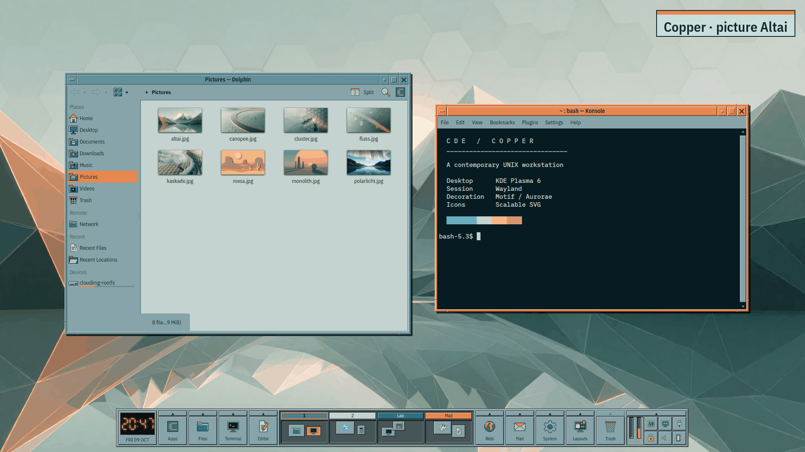
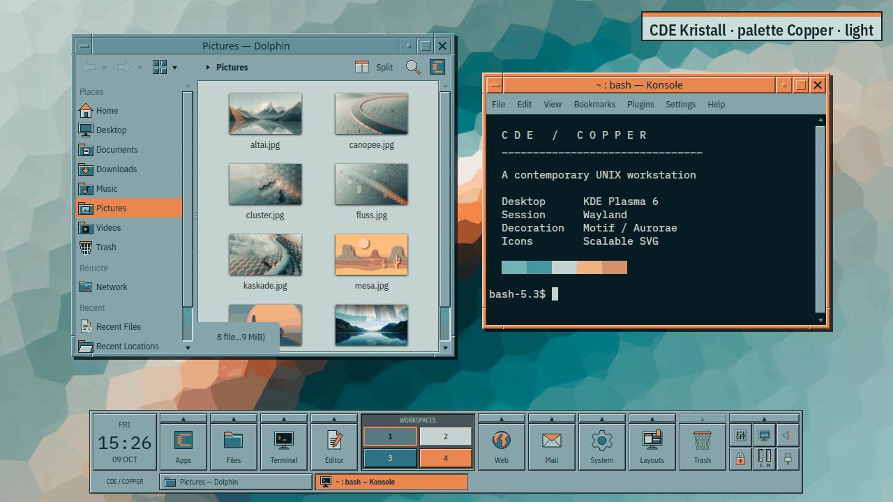
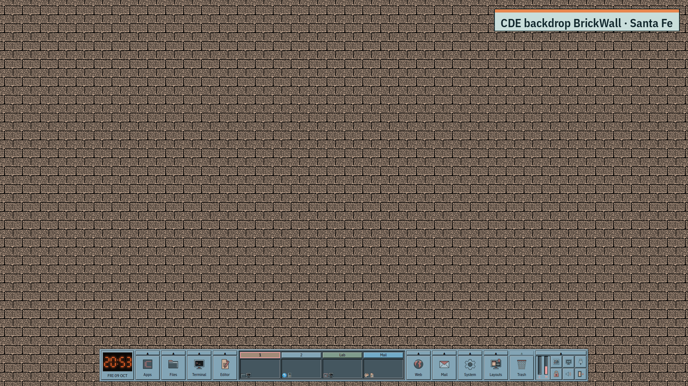
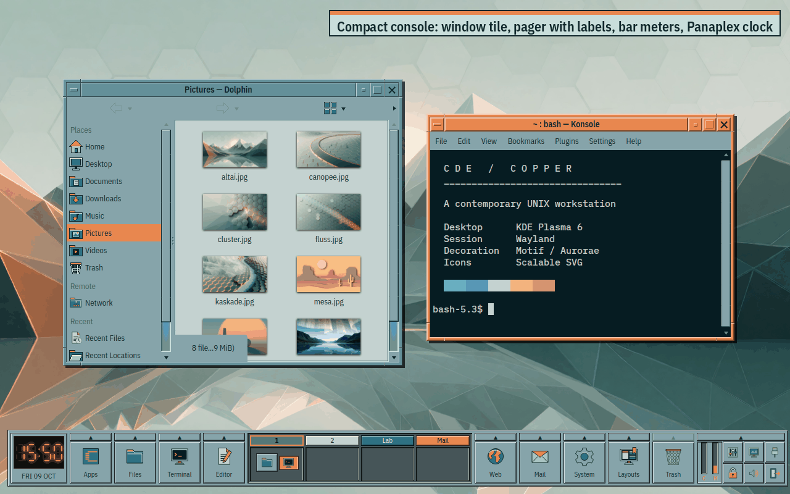
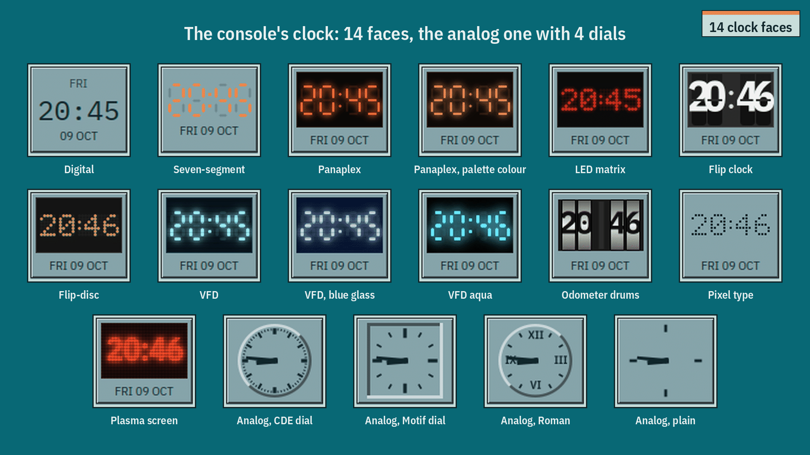
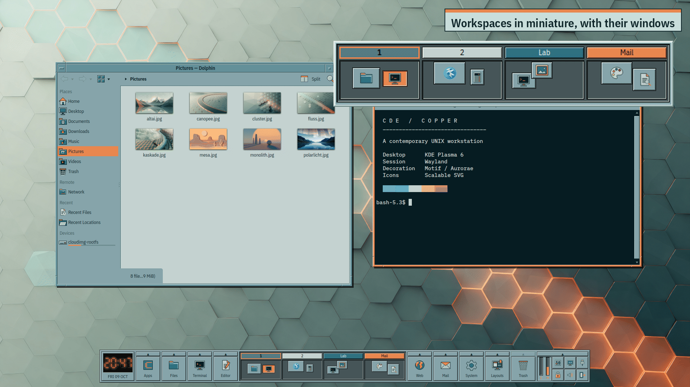
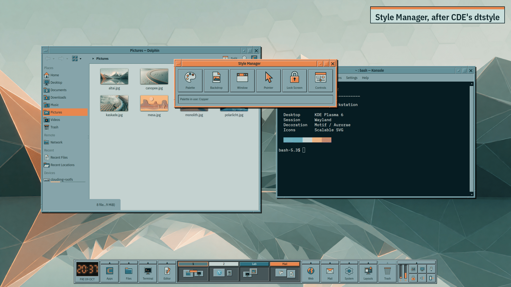
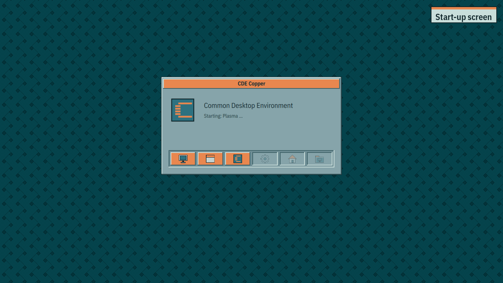

# plasma-theme-lab

A workshop for Plasma 6 themes: a disposable VM for testing, a linter for
Plasma SVGs, a guide — and KDE's reference sources to look things up in.

Grew out of the work on [NiceOS9](https://github.com/huppiflupp/NiceOS9-theme),
but not limited to it.

## CDE Copper

The first finished theme from this workshop: the Common Desktop Environment
for Plasma 6 — front panel, Motif windows, CDE's 37 palettes with icons
and backdrops, clocks, workspaces, Style Manager. Installation and
docs in [`CDE/`](CDE/README.md).

<table>
<tr>
<td width="50%"><br><sub>Palettes with their pictures</sub></td>
<td width="50%"><br><sub>Pictures light and dark</sub></td>
</tr>
<tr>
<td width="50%"><br><sub>CDE's backdrop patterns</sub></td>
<td width="50%"><br><sub>The front panel, set up in different ways</sub></td>
</tr>
<tr>
<td width="50%"><br><sub>14 clocks, 4 dials</sub></td>
<td width="50%"><br><sub>Workspace switcher</sub></td>
</tr>
<tr>
<td width="50%"><br><sub>Style Manager modelled on CDE's dtstyle</sub></td>
<td width="50%"><br><sub>Startup, lock, logout, boot menu</sub></td>
</tr>
</table>

---

## What's here

```
plasma-theme-lab/
├── guide/          guide: building conforming Plasma 6 themes
├── tools/          lint-plasma-svg.py — checks what Plasma silently swallows
├── vm/             test VM (Fedora 44 KDE), set up unattended
├── tests/          test runs and screenshots
├── reference/      cloned KDE sources (breeze, libplasma, plasma-workspace)
└── niceos9/        the theme being reworked
```

## Quick start

**Check a theme — takes seconds, needs no VM:**

```bash
tools/lint-plasma-svg.py niceos9/desktoptheme/niceos9-dark \
    --compare reference/libplasma/src/desktoptheme/breeze
```

**Try a theme in the VM:**

```bash
vm/build-vm.sh                      # once, ~30 min
vm/provision.sh                     # tools, autologin
vm/vmctl.sh snap create clean       # the starting state

vm/vmctl.sh reset                   # back to clean, seconds
vm/vmctl.sh push niceos9 /home/tester/theme
vm/vmctl.sh ssh 'cd theme && ./install.sh'
vm/vmctl.sh shot finding.png
```

## The VM

Fedora 44 KDE (Plasma 6), 6 GB RAM, 4 vCPU, 40 GB. Installed unattended via
kickstart, autologin into the Plasma Wayland session, SSH with
its own key.

It runs under `qemu:///system` — the libvirt service is socket-activated
and membership in the `libvirt` group is enough. **No sudo needed.**

```bash
vm/vmctl.sh status            # state, IP, snapshots
vm/vmctl.sh ssh [command]     # command in the guest
vm/vmctl.sh push <from> <to>  # copy files in
vm/vmctl.sh shot [file]       # screenshot
vm/vmctl.sh snap create|list|revert|rm
vm/vmctl.sh reset             # back to 'clean'
vm/vmctl.sh viewer            # graphical console (interactive)
vm/vmctl.sh viewer-bg         # same, detached in the background
```

**Screenshots come from the hypervisor**, not from the guest (`virsh
screenshot`). That still works when Plasma has crashed
or no session is running any more — exactly the case that is interesting
in theme tests. A tool inside the guest can, by definition, deliver
nothing at that point.

**The snapshot is the real trick.** Without it, the second run tests on
the leftovers of the first.

### Looking in graphically

```bash
vm/vmctl.sh viewer
# equivalent to: virt-viewer --attach -c qemu:///system plasma-lab
```

`--attach` is necessary because the VM runs with `spice,listen=none` — SPICE
does not listen on any network port. Without `--attach`, virt-viewer reports
"Connection failed".

`vmctl.sh viewer` runs in the foreground and blocks the terminal. Anyone who
wants to start the viewer from a script or tool uses
`vmctl.sh viewer-bg`: it creates its own systemd user unit that outlives the
caller's process group. `nohup` and `setsid` are not enough for this
— tools that clean up their process group after the command still
catch the process.

## The linter

Plasma does **not** report missing SVG element IDs — a missing
`hover-center` only shows up as the hover effect not happening. There
is no official tool for this; KDE's CI does not check SVG structure either.

`tools/lint-plasma-svg.py` closes this gap. It checks 9-patch sets per
state prefix, colour scheme binding, `currentColor`, insets and the
required fields in `metadata.json`.

**Calibrated against Breeze:** the reference implementation passes with zero
errors. A linter that complains about the original is complaining wrongly.

## The scaffold generator

A Plasma SVG is not a picture but an atlas: all states of a
widget sit side by side in the same coordinate space, and Plasma cuts
them out by element ID. A `button.svg` thus needs 40+ precisely
named objects — and a typo in an ID is silently
ignored.

`tools/gen-plasma-svg.py` generates this structure from parameters:

```bash
tools/gen-plasma-svg.py --list                      # what is available
tools/gen-plasma-svg.py button                      # to stdout
tools/gen-plasma-svg.py --all -o desktoptheme/mytheme/
tools/gen-plasma-svg.py button --palette platinum-dark --style flat --border 2
```

Knows twelve widget types with their state sets (derived from the Breeze
source tree), sets `hint-*` markers, masks and the
`current-color-scheme` stylesheet. States are distinguished sensibly —
`pressed` inverts the 3D frame, raised becomes sunken.

The result is editable SVG: open it in Inkscape and design the surfaces
without touching the IDs. Or adjust the palette in `PALETTES`
and regenerate.

**Cross-check:** all twelve generated files pass
`lint-plasma-svg.py` without errors.

## The gap list

An icon set of your own is never finished — the question is what comes
next. `tools/missing-icons.py` answers it with numbers instead of
gut feeling:

```bash
tools/missing-icons.py nt-legacy/icons-nt/NTLegacyIcons
tools/missing-icons.py <set> --compare <other-set>   # templates
```

It reads the demand from two sources — `Icon=` from all installed
`.desktop` files and the strings of the KF6 libraries — and
filters it against Breeze: what has no name there, nobody requests
either. What remains is what the system asks for and the set being checked
does not provide, sorted by weight.

The counterpart is `tools/check-symbolic-trap.py`: that one finds names
a set serves **wrongly**, this one the names it does **not** serve
at all.

## The guide

[`guide/`](guide/README.md) — six chapters. It does not repeat the
KDE docs but covers what projects fail on:

1. [The seven layers and their risk](guide/01-layers-and-risk.md)
2. [Plasma Style](guide/02-plasma-style.md) — SVGs, 9-patch, hints, colour schemes
3. [Look-and-feel package](guide/03-look-and-feel.md) — and the panel trap
4. [Building and installing](guide/04-build-and-install.md) — variants without duplicates
5. [Testing](guide/05-testing.md) — four stages
6. [When things go wrong](guide/06-recovery.md) — recovery by escalation level

Plus the [reference card](guide/reference.md).

Statements are marked as *verified*, *source* or *uncertain*. Where the
official docs say something different from the source code, that is noted.

## Reference sources

`reference/` contains shallow clones:

| Directory | What's in it |
|---|---|
| `libplasma/src/desktoptheme/breeze/` | **the Breeze Plasma Style** — 43 widget SVGs |
| `libplasma/src/desktoptheme/breeze-light/` | a variant *without* SVGs — the model for variants |
| `breeze/` | Qt style (`kstyle/`) and window decoration (`kdecoration/`) |
| `plasma-workspace/` | look-and-feel packages, SDDM theme |

**Most common mistake:** the `plasma/breeze` repo contains no Plasma Style.
That lives in `libplasma`.

## Ground rules

1. A theme you cannot try out safely is not a finished theme.
2. What lives in `$HOME` and what reaches into the system belong in separate scripts.
3. If you want to ship a panel layout, back up the user's first.
4. Build variants from one source, not by copy-paste.
5. Bump `KPlugin.Version` with every release — it is the cache key.
