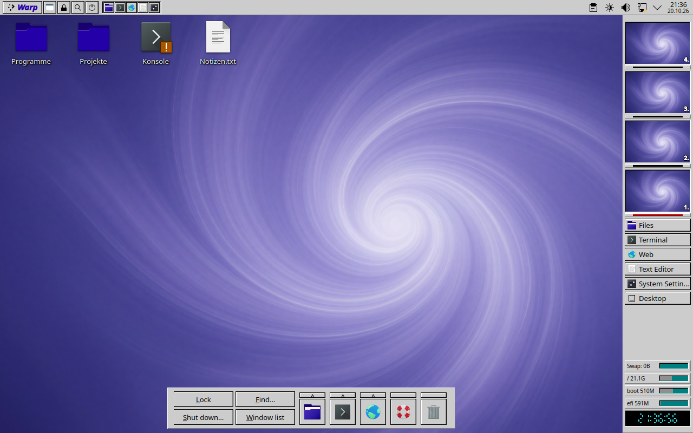
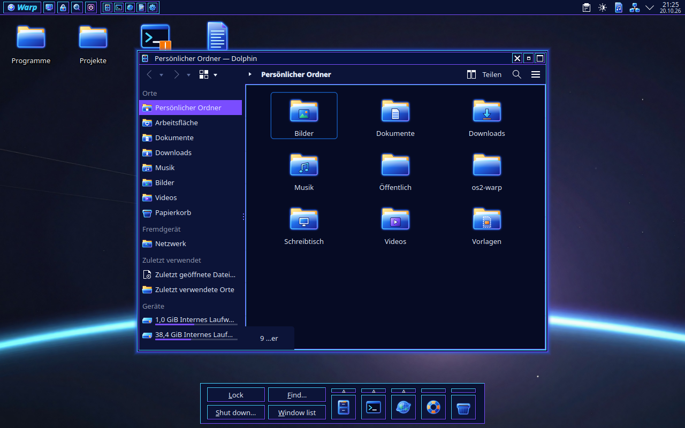

# Warp Legacy

OS/2 Warp 4 for KDE Plasma 6, in two variants: the classic Warp 4 grey,
and **Neon**, OS/2 at night with cyan and violet glowing edges.




Not affiliated with IBM, Arca Noae or Stardock. "OS/2" and "Warp" are
trademarks of IBM; nothing of IBM's or Stardock's is included: the icons,
wallpapers and panels are drawn and written anew (DESIGN.md §1).

## What it brings

| Part | Classic | Neon |
|---|---|---|
| Window frame | grey sizing border, program icon as window menu, inset blue title, close beside hide and maximize | the same in navy, cyan/violet edges, a glow around the window |
| Programs (Kvantum) | raised grey buttons with a black outline, sunken fields, round radio buttons | the same edges in cyan and violet |
| Plasma style, colours | Warp 4's grey and blue | navy, cyan, violet |
| Icons | Breeze (a set of its own is planned) | Warp Legacy Neon, glowing |
| Wallpaper | violet swirl (16 pictures to choose from) | planet horizon |

The panels, shared by both variants:

- **Warp Bar** (top, after the WarpCenter): the desktop menu cascades from
  the desktop's objects and the drives down into every folder; window list,
  lock, find, shut down; a tray of launchers. Plasma's system tray and
  clock sit at its right end.
- **LaunchPad** (bottom centre): Lock, Find, Shut down, Window list, and
  launchers with drawers that open upwards.
- **Control Strip** (right edge, after Object Desktop): the workspaces in
  miniature, a launch list, swap and disk gauges, a seven-segment clock.
- **Tab Launcher** (not in the default layout): notebook tabs with the open
  windows, your favourites and the application menu's categories, in a
  drawer at the bottom left that slides into the screen edge like Mac OS 9's
  Control Strip.

The lock screen shows the neon tubes of OS/2's Lockup in both variants.

## Install

Needs Plasma 6 and, for the program style, Kvantum (`kvantum` package).

```bash
./install.sh                     # install both variants
./install.sh --apply             # … and switch to Warp Legacy
./install.sh --apply neon        # … and switch to Warp Legacy Neon
./install.sh --apply --layout    # … and replace the panels with Warp Legacy's
```

Log out and back in afterwards: the window frame and some settings only
take effect in a new session.

```bash
./uninstall.sh
```

puts back what `--apply` changed (colour scheme, styles, icon theme,
window frame and button order, lock screen picture, the number of
workspaces), the panels from before `--layout`, and the global theme in
use before, then removes the files. Tested on a clean Fedora 44 VM: the
panel afterwards is pixel for pixel the one before.

## Building

`build.py` generates everything into `build/` (colour schemes, Plasma
styles, decorations, Kvantum themes, icons, wallpapers, plasmoids,
translations, global themes). `install.sh` builds when `build/` is missing.

| File | What |
|---|---|
| `DESIGN.md` | the specification, measured from the reference screenshots |
| `build.py` | the variants, their palettes and packages |
| `decoration/` | the QML window frame (`Style.qml` is written per variant) |
| `kvantum.py` | the program style (copied from CDE Copper, OS/2 edges) |
| `tools/gen-plasma-svg.py` | the Plasma style (copied from NT Legacy's tools) |
| `icons_neon.py` | the Neon icon set (PNG, as Qt's SVG renderer draws no glow) |
| `common/` | edges, buttons, launching, window list: copied into every plasmoid |
| `launchpad/`, `warpbar/`, `controlstrip/`, `tablauncher/` | the panels |
| `layout.js` | the global themes' panel layout |
| `wallpapers/` | the pictures (generated locally, prompts and seeds in the JSON beside each) |
| `po/` | translations (German) |
| `fetch-reference.sh` | the reference screenshots DESIGN.md is measured from (not in the repository) |

Parts taken from CDE Copper are copies, each with a note of where it came
from; Warp Legacy and CDE Copper share no files (see the repository's
CLAUDE.md).

## Licence

GPL-2.0-or-later.
