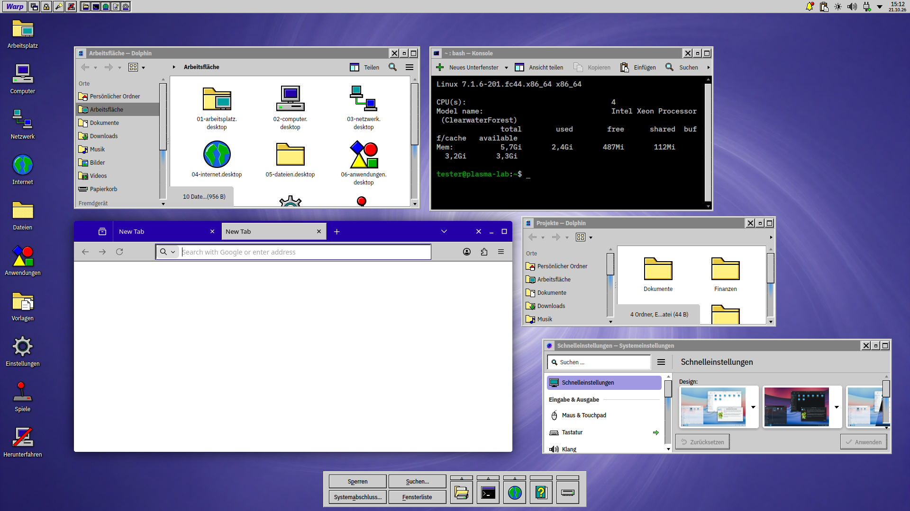
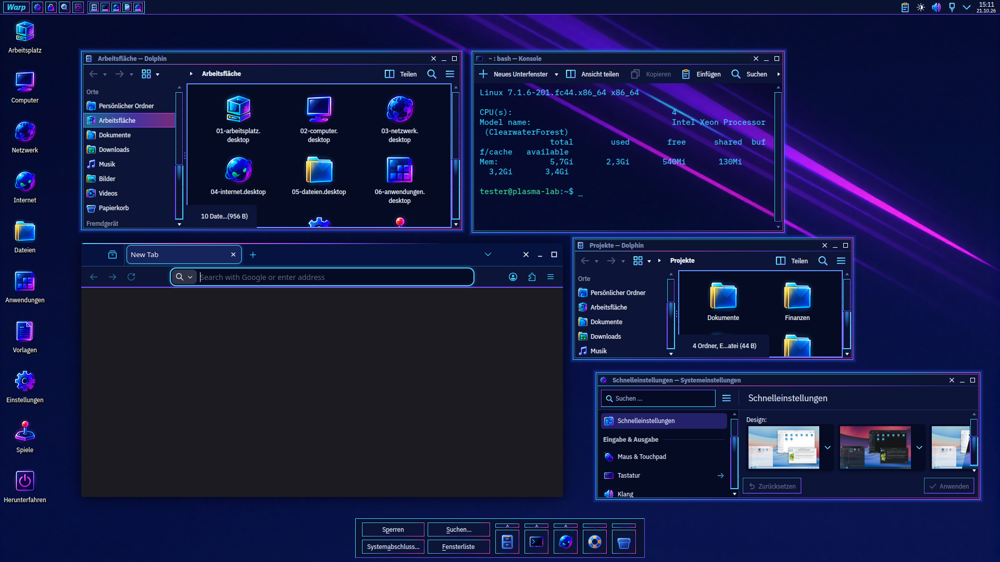
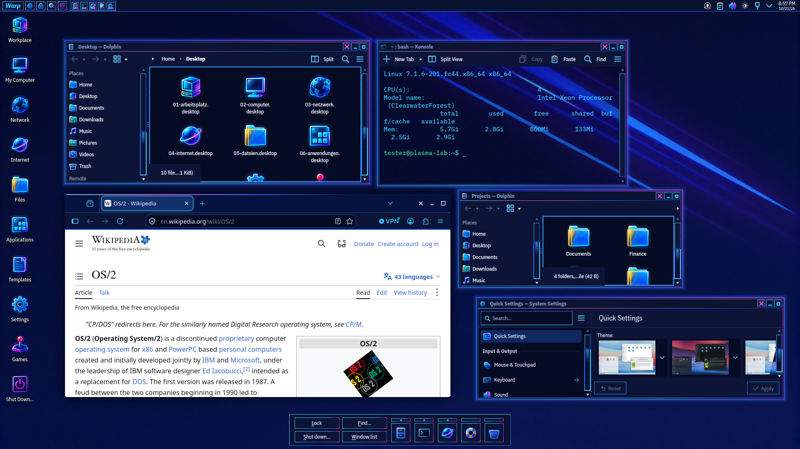

# Warp Legacy

OS/2 Warp 4 for KDE Plasma 6, in three variants: the classic Warp 4 grey;
**Neon**, OS/2 at night with cyan and violet glowing edges; and **Neon
Blue**, the same night in blue, closest to the concept
(`reference/neon-2026.png`), pink only as an accent.





Not affiliated with IBM, Arca Noae or Stardock. "OS/2" and "Warp" are
trademarks of IBM; nothing of IBM's or Stardock's is included: the icons,
wallpapers and panels are drawn and written anew (DESIGN.md §1).

## What it brings

Neon Blue is Neon with these changes: electric blue `#2a6cff` where Neon
is violet (frame edges, Kvantum, panels, LibreOffice and Firefox marks),
blue selections, the concept's colourful icons (Warp Legacy Neon 2026)
instead of the violet set, the light streaks wallpaper in blue, mouse
cursors running cyan, blue, pink.

| Part | Classic | Neon |
|---|---|---|
| Window frame | grey sizing border, program icon as window menu, inset blue title, close beside hide and maximize | the same in navy, cyan/violet edges, a glow around the window |
| Programs (Kvantum) | raised grey buttons with a black outline, sunken fields, round radio buttons | the same edges in cyan and violet |
| Plasma style, colours | Warp 4's grey and blue | navy, cyan, violet |
| Icons | Breeze (a set of its own is planned) | Warp Legacy Neon, glowing |
| Wallpaper | violet swirl (16 pictures to choose from) | planet horizon |
| Mouse cursors | Breeze | Breeze's, the rim in the frames' light (made at build time from the Breeze cursors) |
| Konsole | Warp Legacy profile | dark profile, 80 % transparent by default |
| LibreOffice (application colours) | white page on Warp grey, Warp blue marks | navy page on near black, violet text boundaries, pink spelling marks ([libreoffice/README.md](libreoffice/README.md)) |

The panels, shared by both variants. The global theme's layout (taken
with "Use desktop layout from theme", or `install.sh --layout`) has the
taskbar along the bottom, the Control Strip as a compact box at the top right and the Tab
Launcher's drawer at the top left; the screenshots show the Warp Bar along
the top with the LaunchPad below (`tools/demo-scene.sh --panels
screenshots`). The plasmoids' settings page "Panels" adds or removes each.

- **Warp Taskbar** (bottom, after the Neon concept): Start opens the Warp
  menu, then the workspaces and a button per window; Plasma's system tray
  and clock beside it.
- **Warp Bar** (top, after the WarpCenter): the desktop menu cascades from
  the desktop's objects and the drives down into every folder; window list,
  lock, find, shut down; a tray of launchers. Plasma's system tray and
  clock sit at its right end.
- **LaunchPad** (bottom centre): Lock, Find, Shut down, Window list, and
  launchers with drawers that open upwards.
- **Control Strip** (right edge): by default the Neon concept's compact
  box at the top right (clock, date, CPU, RAM, disk, appointments or a
  saying); in its settings also the full strip after Object Desktop, with
  the workspaces in miniature, a launch list, gauges, a seven-segment clock.
- **Tab Launcher**: notebook tabs with the open windows, your favourites
  and the application menu's categories, in a drawer that slides into the
  screen edge like Mac OS 9's Control Strip.

The Meta key opens the Warp menu (from the taskbar or the Warp Bar), and
typing in it finds programs at once: the best match is highlighted, next
to the field, so Meta, `kon`, Return starts Konsole. A step away from the
field picks the next match, Escape closes; programs started this way move
up next time. With nothing typed the arrow keys walk the menu: right opens
a folder or category, left goes back.

**Switching variants:** the Warp menu's "Switch to Warp Legacy Neon" (or
back) changes everything at once without logging out: the global theme,
Kvantum, icons, cursors, Konsole, LibreOffice, the wallpaper; the panels
stay. Plasma's shell restarts for it; programs already open take the new
style when started again. From a terminal:
`~/.local/share/warp-legacy/warp-legacy-switch [neon|neon-blue|classic|toggle]`;
toggle (and the Warp menu) goes from either Neon to classic and back to
the Neon used last.

The lock screen shows the neon tubes of OS/2's Lockup: on black in both Neons,
on OS/2's grey in classic.

The window buttons come in six looks (System Settings › Colours & Themes ›
Window Decorations › the frame's settings): Warp 4's raised squares, the
glyphs only, diamonds, window corners, neon tubes and tiles. Neon draws the
glyphs glowing cyan in every look, close in pink.

## Install

Needs Plasma 6 and, for the program style, Kvantum (`kvantum` package).

```bash
./install.sh                     # install all three variants
./install.sh --apply             # … and switch to Warp Legacy
./install.sh --apply neon        # … and switch to Warp Legacy Neon
./install.sh --apply neon-blue   # … and switch to Warp Legacy Neon Blue
./install.sh --apply --layout    # … and replace the panels with Warp Legacy's
```

Log out and back in afterwards: the window frame and some settings only
take effect in a new session.

```bash
./uninstall.sh
./uninstall.sh --keep-firefox   # leave Firefox's Warp Legacy look in place
```

It stops while LibreOffice runs, and while Firefox still wears the theme
(`firefox-apply.sh remove` first, or `--keep-firefox`).

puts back what `--apply` changed (colour scheme, styles, icon theme,
window frame and button order, lock screen picture, the number of
workspaces), the panels from before `--layout`, and the global theme in
use before, then removes the files. LibreOffice's colours
(`--apply` switches them only while LibreOffice is closed and only from
its "Automatic" scheme) go back the same way; `uninstall.sh` asks to
close LibreOffice first. Tested on a clean Fedora 44 VM: the
panel afterwards is pixel for pixel the one before.

## Building

`build.py` generates everything into `build/` (colour schemes, Plasma
styles, decorations, Kvantum themes, icons, wallpapers, plasmoids,
translations, global themes). `install.sh` builds when `build/` is missing.

| File | What |
|---|---|
| `DESIGN.md` | the specification, measured from the reference screenshots |
| `build.py` | the variants, their palettes and packages |
| `decoration/` | the QML window frame (`Style.qml` is written per variant) |
| `kvantum.py` | the program style (copied from CDE Copper, OS/2 edges) |
| `tools/gen-plasma-svg.py` | the Plasma style (copied from NT Legacy's tools) |
| `icons_neon.py` | the Neon icon set (PNG, as Qt's SVG renderer draws no glow) |
| `common/` | edges, buttons, launching, window list: copied into every plasmoid |
| `launchpad/`, `warpbar/`, `controlstrip/`, `tablauncher/` | the panels |
| `layout.js` | the global themes' panel layout |
| `wallpapers/` | the pictures (generated locally, prompts and seeds in the JSON beside each) |
| `libreoffice/` | LibreOffice's application colours: extension and `libreoffice-apply` |
| `po/` | translations (German) |
| `fetch-reference.sh` | the reference screenshots DESIGN.md is measured from (not in the repository) |

Parts taken from CDE Copper are copies, each with a note of where it came
from; Warp Legacy and CDE Copper share no files (see the repository's
CLAUDE.md).

## Release

`python3 package.py` makes a full build and packs it with the installer
into `dist/warp-legacy-<version>.tar.xz` (no build needed to install from
it). RELEASE-CHECKLIST.md is the test plan, TESTING.md the log.

`python3 store.py` (after a full build) makes the KDE Store edition in
`dist/store/<version>/`: one archive per store entry, the global themes
fetching the rest as dependencies. It uses Breeze widgets and an SVG
version of the frame, and leaves out what only `install.sh` does
(warp-legacy-sync, the button order, Kvantum, Konsole, LibreOffice,
Firefox, IBM Plex, the lock screen picture); see STORE.md.

## Licence

GPL-2.0-or-later (LICENSE); the IBM Plex fonts under the SIL Open Font
License 1.1.
