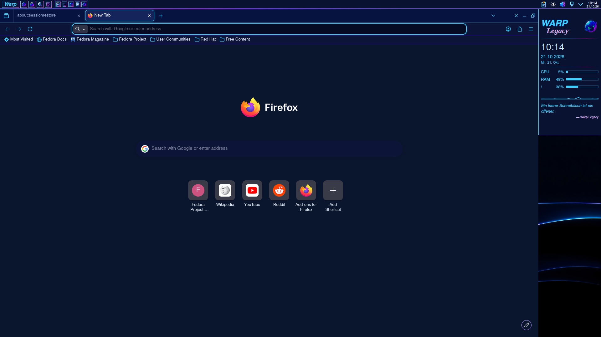
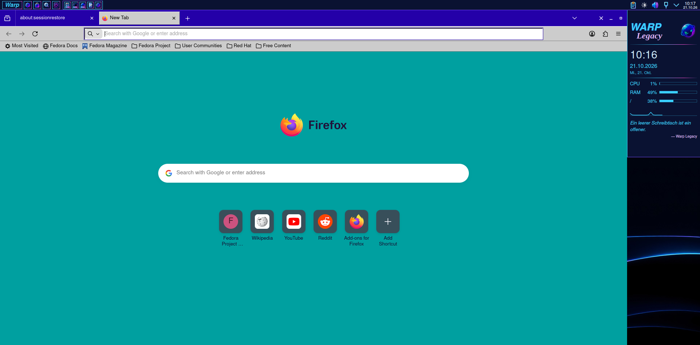
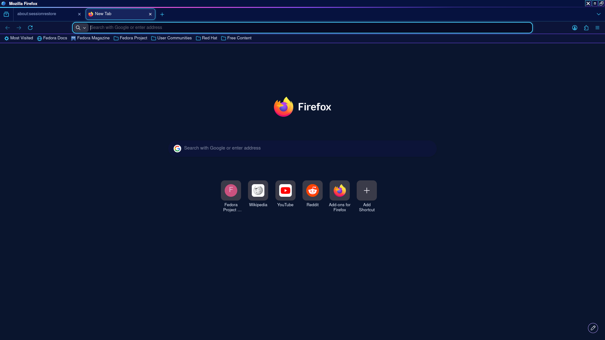

## Browsers

Firefox and Chrome draw their own title bar and toolbars and take neither
Plasma's colours nor its window frame. Warp Legacy therefore brings browser
themes of its own, in both variants, generated from the same palettes as
the rest of the theme (`browser/build_browser.py`, output in
`build/warp-legacy/browser/`, installed to `~/.local/share/warp-legacy/browser/`).

| | Warp Legacy | Warp Legacy Neon |
|---|---|---|
| Tab strip | Warp blue `#2400a8` (inactive window grey `#808080`), white text and icons | navy `#06123f`, a lit edge on top: cyan → pink → violet |
| Selected tab | grey `#cccccc`, raised (white top/left, grey bottom/right) | `#16245c`, cyan outline with a faint glow |
| Toolbar | grey `#cccccc`, black icons | navy `#0c1438`, cyan icons, violet line below |
| Address field | white, sunken, blue when focused | `#060b24`, cyan glow when focused |
| Menus | grey, black frame, blue selection | navy, cyan frame, blue `#1a6fe0` selection |
| New tab | Warp 3's teal `#00a0a0` | the Neon desktop `#0a152e` |
| Window buttons | white `× _ □` | white `× _ □` |




### Firefox

Firefox (release builds) installs only add-ons signed by Mozilla, also
themes. So there are two ways:

**Recommended, no signature needed: `firefox-apply.sh`.** It puts the theme
into the Firefox profile as `userChrome.css`/`userContent.css`, which
Firefox reads when `toolkit.legacyUserProfileCustomizations.stylesheets` is
on. Nothing happens on install; you run it yourself:

```sh
~/.local/share/warp-legacy/browser/firefox-apply.sh neon      # or: classic
~/.local/share/warp-legacy/browser/firefox-apply.sh remove    # undo everything
~/.local/share/warp-legacy/browser/firefox-apply.sh status
```

- Close Firefox first; the script refuses while it runs.
- It finds the profiles Firefox starts with in `~/.mozilla/firefox`,
  `~/.config/mozilla/firefox`, Flatpak (`~/.var/app/org.mozilla.firefox/…`)
  and Snap. `--all` for every profile, `--profile DIR` for one.
- It writes only into `<profile>/chrome/warp-legacy/`, adds one marked
  `@import` block to `chrome/userChrome.css` and `chrome/userContent.css`
  (your own rules there stay untouched) and one marked block to `user.js`.
  `remove` takes all of it back, including the prefs Firefox copied into
  `prefs.js`.
- `--system-titlebar` also turns off Firefox's own title bar
  (`browser.tabs.inTitlebar=0`): the window then gets Warp Legacy's KWin
  frame with its title bar above the tabs.



Limits: `userChrome.css` styles Firefox's internals, which Mozilla changes
without notice. The theme sets Firefox's own theme variables (as of Firefox
153) and only a few selectors (`#TabsToolbar`, `#nav-bar`, `.tab-background`,
`#urlbar-background`, `.titlebar-button`); after a major Firefox update
parts may fall back to Firefox's default look, nothing breaks. Web pages are
not themed; only the new tab and home page get the variant's background.

**As a real Firefox theme:** `firefox/warp-legacy.xpi` and
`firefox/warp-legacy-neon.xpi` are ordinary static themes (`manifest.json`
with `theme.colors`). Unsigned, Firefox loads them only temporarily, until
the next restart: `about:debugging` → *This Firefox* → *Load Temporary
Add-on…* → the `.xpi`. To install them for good they have to be signed on
addons.mozilla.org (a free account; "On your own" distribution signs
without a public listing), then they install with a click. Firefox ESR,
Developer Edition and Nightly also accept unsigned add-ons after setting
`xpinstall.signatures.required` to `false`.

### Chrome, Chromium, Brave, Vivaldi

`chrome/warp-legacy/` and `chrome/warp-legacy-neon/` are Chrome themes
(`manifest.json` with `theme.colors`). To install without the Chrome Web
Store: `chrome://extensions` → *Developer mode* on → *Load unpacked* → pick
the folder. The theme stays across restarts. The `.zip` files beside them
are what the Web Store expects for an upload.

Chrome themes colour the frame, tabs, toolbar, address field and new tab
page; menus follow Chrome's light or dark mode and cannot be themed.
