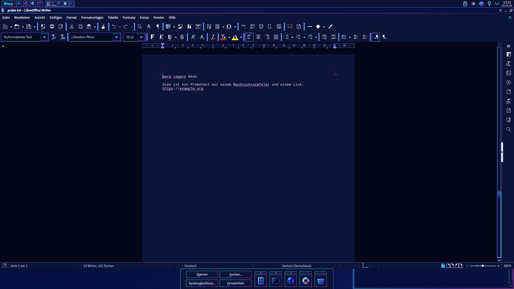

## LibreOffice

With the kf6 (or qt6) VCL plugin, which Plasma's LibreOffice picks by
itself, LibreOffice draws its menus, toolbars, sidebar and dialogs with
the Kvantum style `Warp`/`WarpNeon` and the Plasma colour scheme: that part
needs nothing of its own. What it does not take from Plasma are the colours
of the document area, LibreOffice's *Application Colors*. Under Neon they
came out as a grey-teal page on a bright blue workspace.

Warp Legacy therefore brings two colour schemes of its own, generated from
the palettes in `build.py` (`libreoffice/build_libreoffice.py`), as a
configuration-only extension `warp-legacy.oxt`:

| | Warp Legacy | Warp Legacy Neon |
|---|---|---|
| Page | white `#ffffff` | navy `#0c1438`, automatic text light `#e8f0ff` |
| Workspace around it | grey `#808080` | near black `#020617` |
| Text and section boundaries | grey | violet `#7a4dff` |
| Calc grid | `#c0c0c0` | `#26346e` |
| Calc cell focus, marked headers | Warp blue `#2400a8` | selection blue `#1a6fe0` |
| Spelling, grammar | red, blue | pink `#ff4fd8`, cyan `#48cffe` |
| Links | `#2400a8`, visited `#600080` | `#3ad0ff`, visited `#b48cff` |
| Field shadings, comments | grey, pale yellow | `#16245c` |

The UI colours LibreOffice could override as well (window, menu, button …)
stay automatic, so they never fight with Kvantum.



### Installing

`install.sh --apply [neon]` installs the extension and switches to the
variant's scheme, **only if LibreOffice is closed** and the user has not
chosen application colours of their own (anything but LibreOffice's
"Automatic"); a scheme you chose stays, and the two Warp schemes are
merely added to the list. By hand, with LibreOffice closed:

```sh
~/.local/share/warp-legacy/libreoffice/libreoffice-apply neon      # or: classic
~/.local/share/warp-legacy/libreoffice/libreoffice-apply remove
~/.local/share/warp-legacy/libreoffice/libreoffice-apply status
```

Or in LibreOffice itself: Tools › Options › LibreOffice › Application
Colors (Extras › Optionen › LibreOffice › Anwendungsfarben), scheme
"Warp Legacy Neon" or "Warp Legacy".

- The script refuses while LibreOffice runs: LibreOffice writes its whole
  configuration back on exit and would undo the change.
- It installs the extension with `unopkg` (per user, `Warp-Legacy-Farben`
  in the Extension Manager) and writes one key into
  `~/.config/libreoffice/4/user/registrymodifications.xcu`:
  `/org.openoffice.Office.UI/ColorScheme/CurrentColorScheme`. The value
  before is kept in `~/.local/share/warp-legacy-install/libreoffice.before`.
- `remove` (run by `uninstall.sh`) puts that value back, unless you have
  switched to yet another scheme meanwhile, and removes the extension.
  `uninstall.sh` stops before touching anything while LibreOffice runs.

Limits:

- Switching the variant in System Settings › Global Theme switches
  LibreOffice at the next login (`warp-legacy-sync`, with `--if-default`),
  and only if LibreOffice is closed then; at once: `libreoffice-apply`.
- Only the native packages' profile (`~/.config/libreoffice/4/user`) is
  handled, not the Flatpak or Snap one; there, install `warp-legacy.oxt`
  through Tools › Extensions and choose the scheme in the options.
- With the gtk3 plugin (`SAL_USE_VCLPLUGIN=gtk3`) the document colours
  still apply, but the window around them follows GTK, not Kvantum.
- The page colour is a screen colour only: printing and PDF export keep the
  document's own colours (white unless the document sets one).
